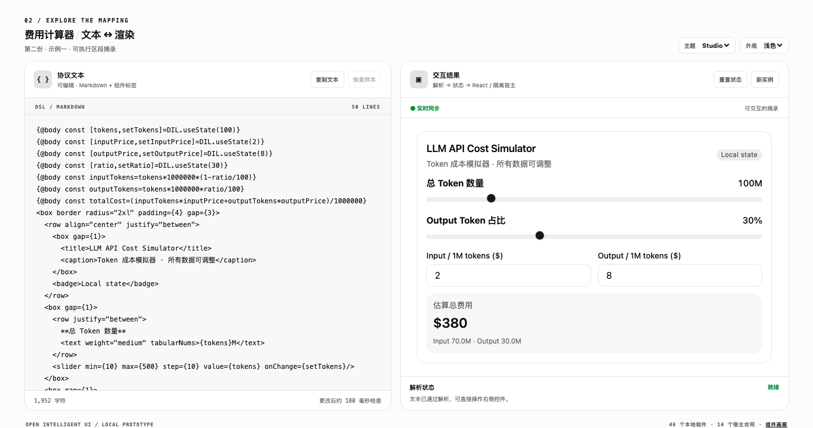
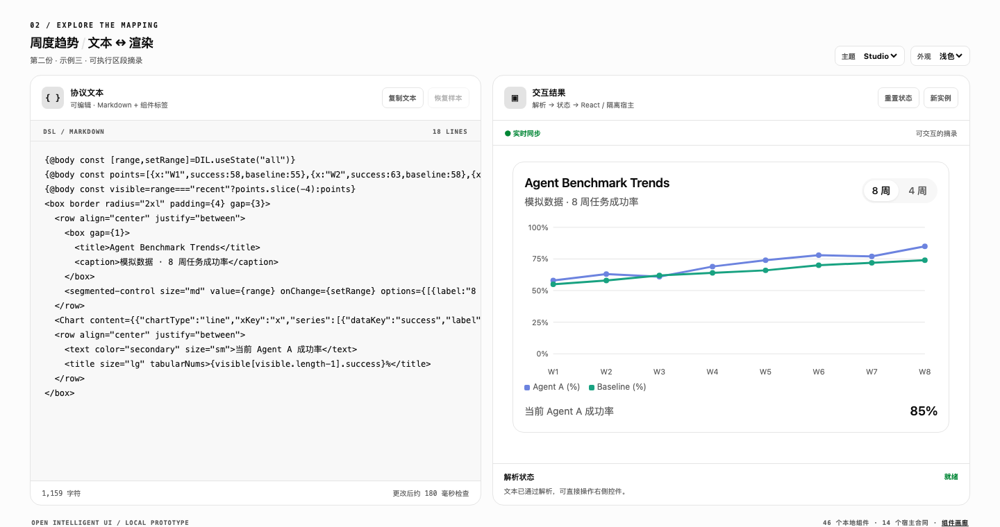
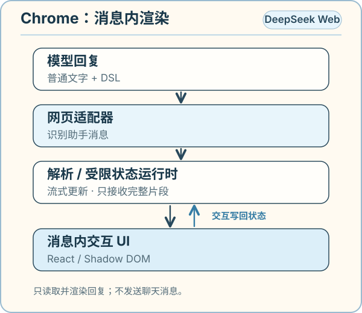
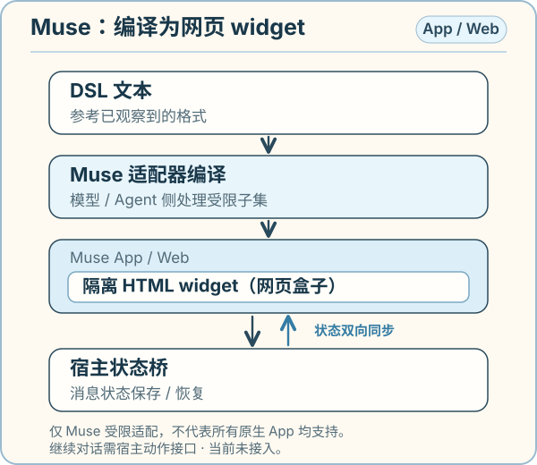

# Open Intelligent UI


## 功能介绍

Open Intelligent UI 用独立的组件 DSL，把模型回复中的文字、表单和图表变成可交互界面。滑块、输入框和图表由同一条消息的状态驱动；普通文字仍可与界面混排。这是非官方实现，参考已观察到的 Intelligent UI 输出格式，不保证与 OpenAI 的私有协议完全一致。背景可读 [GPT‑6 与 Intelligent UI 原文](https://openai.com/index/gpt-6-for-everyone/)。

以下是本项目 **本地 playground** 在 Mac Chrome 中的真实截图：左侧为可编辑的 DSL，右侧为运行结果；它们不是 DeepSeek 或 Muse 的页面截图。



*费用计算器：调整 token 数量、比例或单价，右侧费用即时重算。*



*周度趋势：切换 8 周 / 4 周视图，图表随之更新；图中是模拟数据。*

### 本地体验

需要 Node.js 20.19+ 或 22.12+。在仓库根目录运行：

```bash
npm install
npm run dev
```

然后打开 [交互工作台](http://127.0.0.1:5173/)；[组件画廊](http://127.0.0.1:5173/test/)展示更多组件。

## 原理：App 与 Chrome 插件如何实现

### Chrome 网页



*Chrome：插件识别 DeepSeek 助手正文中的 DSL，流式渲染完整片段；用户交互写回消息状态，关闭后恢复网页原文。*

### Muse App / Web



*Muse：Agent 侧的适配器将受支持的 DSL 编译成隔离 widget；宿主状态桥保存 / 恢复状态，聊天提交尚未接入。*

自有 React 应用可以组合协议解析器、状态运行时和 React 组件自行接入。

OpenAI 的原文介绍的是**原生、可流式组件和编译器**。本项目实现已知格式的解析、运行时与宿主适配，不代表其官方实现。先看[当前能力总览](docs/CAPABILITIES.zh-CN.md)，协议和安全边界见[协议说明](docs/PROTOCOL.zh-CN.md)。

## 当前支持的 App / Web

| 环境 | 当前状态 | 范围 |
| --- | --- | --- |
| DeepSeek Web + Chrome 插件 | 已适配，用户反馈可用 | 识别助手正文中的 DSL；支持流式输出和普通文字 / UI 混排。 |
| DeepSeek Harness Web / Desktop | 本地 `0.2.0-rc.2` 已加载验证 | 在助手文本块中混排 Markdown / IUI、预览流式安全前缀、保留本地交互状态；未接宿主动作。 |
| 本地保存的 DeepSeek HTML + Chrome 插件 | 有条件可用 | 需给扩展文件网址权限，并配置匹配该文件的 URL 规则。 |
| Muse App / Web | 受限子集，用户亲测可用 | 将 DSL 编译为 HTML widget；不是全量协议兼容，不能由 widget 直接提交消息。 |
| 自有 React 应用 | 可集成 | 可使用解析器、运行时与组件；聊天动作需由应用提供。 |
| ChatGPT、Claude、Gemini 网页 | 未专门适配 | 尚无对应网页消息适配器。 |
| DeepSeek 原生 App | 未支持 | Chrome 插件仅作用于网页。 |

按环境查看 [DeepSeek 网页适配器](packages/chrome-extension/README.md)、[dsh 插件](packages/dsh-plugin/README.md)、[Muse 适配器](packages/muse-app-adapter/README.md)。标签、渲染与宿主能力的差异见[能力总览](docs/CAPABILITIES.zh-CN.md)和[组件兼容矩阵](docs/COMPATIBILITY.zh-CN.md)；另见[AppBlock 安全说明](docs/APPBLOCK.zh-CN.md)、[模型输出提示词](docs/MODEL_PROMPT.zh-CN.md)及[验证记录](docs/DEEPSEEK_EXTENSION.zh-CN.md)。
