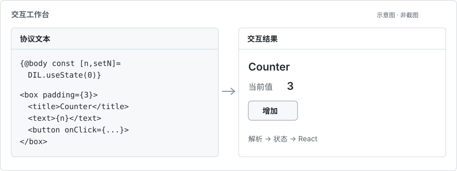
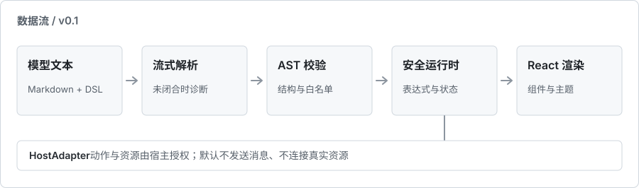

# Open Intelligent UI


Open Intelligent UI 是一套独立的交互 UI 协议 v0.1 和 TypeScript / React 参考实现。它将 Markdown 与受限组件 DSL 解析为可交互界面，用消息级状态保存输入，用宿主接口处理需要授权的动作。

这是一个**本地实验项目**，包含基于保存页静态结构开发的 DeepSeek Chrome MV3 扩展；尚未在真实账号页面安装验证，也未发布为 npm 包。它不声称兼容任何网站的私有协议。

## 快速开始

在仓库目录执行：

```bash
npm install
npm run dev
```

打开 [http://127.0.0.1:5173/](http://127.0.0.1:5173/) 查看交互工作台，或打开 [组件画廊](http://127.0.0.1:5173/test/)。当前 Vite 依赖要求 Node.js 20.19+（20.x）或 22.12+。

```bash
npm test            # 自动化测试
npm run typecheck   # TypeScript 检查
npm run build       # 库、JSON Schema 和静态演示
```

包目前标记为 `private`。项目还没有 lockfile；此前本机因 npm 注册表 DNS 不通，测试使用已有依赖目录，干净环境的独立安装尚未验证。

## 一个最小示例

```jsx
{@body const [count,setCount]=DIL.useState(0)}
{@body const doubled=count*2}
<box border padding={3} gap={2}>
  <title>计数器</title>
  <text>当前 {count} · 两倍 {doubled}</text>
  <button onClick={()=>setCount(previous=>previous+1)}>增加</button>
</box>
```

在实际模型回复中，DSL 应直接写在正文里；这里的代码围栏仅用于文档展示，围栏内容不会被激活。解析器只接受白名单组件和受限表达式，不对模型源码使用 `eval` 或 `new Function`。完整语法见[协议规范](docs/PROTOCOL.zh-CN.md)，用于指导其他模型输出的文本见[提示词](docs/MODEL_PROMPT.zh-CN.md)。

## 交互工作台

工作台把可编辑的协议文本和实际解析器、运行时、React 渲染结果放在同一页。它有七个场景：计算器、任务表单、趋势图、控件集锦、模拟评测台，以及需用户明确点击才能运行的俄罗斯方块和画板。可切换 Studio / Citrus 主题与明暗模式。



*结构示意，非真实截图。场景来源、可操作项与验证情况见[工作台说明](test/playground/README.zh-CN.md)和[本地验证记录](docs/VERIFICATION.zh-CN.md)。*

## 实现结构



- `protocol/`：DSL 解析、结构校验、JSON Schema、受限表达式和消息状态；不依赖 React。
- `ui/`：组件、渲染器与主题；`packages/react-ui/` 汇总公开的 React 导出。
- `services/`：站点适配、消息生命周期与独立渲染视图；DeepSeek 网页可选[统一智能 UI 开关](docs/CHROME_INTELLIGENT_LAYOUT.zh-CN.md)，经核实的发送契约独立于通用渲染层。
- `packages/chrome-extension/`：未打包 MV3 扩展装配；静态适配 DeepSeek 的助手正文，可手动加载验证。使用方法见[扩展说明](packages/chrome-extension/README.md)。
- `packages/dsh-plugin/`：DeepSeek Harness Web / Desktop 的助手消息渲染插件；使用方法见[插件说明](packages/dsh-plugin/README.md)。

项目内可以这样组合解析器与渲染器。以下相对路径以仓库根目录的入口文件为基准：

```tsx
import { parseDsl, Runtime } from './protocol';
import { ThemeProvider, UIRenderer } from './packages/react-ui';
import './ui/styles.css';

const source = '<title>Hello, UI</title>';
const runtime = new Runtime(parseDsl(source, 'message-1'));

export function Demo() {
  return <ThemeProvider name="studio" mode="light">
    <UIRenderer runtime={runtime} />
  </ThemeProvider>;
}
```

构建后可使用包导出路径 `open-intelligent-ui/protocol`、`open-intelligent-ui/react-ui` 与 `open-intelligent-ui/styles.css`；包仍为私有、未发布。主题 token 的可覆盖范围见[主题说明](docs/THEMES.zh-CN.md)。

## 能力与限制

| 环境 | 当前接线 | 边界 |
| --- | --- | --- |
| DeepSeek 网页 + Chrome 扩展 | 助手正文中的 DSL、普通文字混排、流式安全前缀与本地交互状态 | 只解析两个精确项目图片查询；不发送消息 |
| DeepSeek Harness Web / Desktop | 助手文本块中的 Markdown / IUI、流式安全前缀与本地交互状态 | 未接图片、`AppBlock`、回传会话或本机系统动作 |
| Muse App / Web | Agent 将 10 个标签的子集编译成 HTML widget，状态经 widget 桥保存 | 不自动替换聊天正文，不支持流式增量更新或 widget 直接发消息 |

标签能被解析不等于适配器实现了同名宿主能力。详细差异见[当前能力总览](docs/CAPABILITIES.zh-CN.md)，三个适配器分别见[DeepSeek 网页](packages/chrome-extension/README.md)、[dsh](packages/dsh-plugin/README.md)和[Muse](packages/muse-app-adapter/README.md)。

注册表有 61 个名称，其中 **46 个有本地 React 参考映射**。本地图表支持折线、柱、散点和饼图，最多 100 条数据、4 个 series；这是基础实现，没有完整 Tooltip 或复杂轴配置。

`AsyncImage` 与 `AsyncImageGroup` 已有受限宿主：只把两个精确查询解析为本项目自有的 README 横幅和扩展图标，不联网搜图，也不把它们当成其他主题的照片。其余媒体、地图、实体、引用、文件及 `WritingBlock` 等 **11 个宿主组件默认未配置**。本地工作台的 `AppBlock` 仅能在用户点击后运行两份内容与身份精确匹配的已审阅样本；Chrome 扩展不配置 AppBlock 授权，因此聊天回复中的任意 HTML / JS 都不能运行。`CodeBlock` 仅展示原文，不执行 TSX 或 Mermaid；模型提供的任意 `svg` 会被拒绝。扩展只读已显示的 DeepSeek 助手正文，真实站点行为尚未验证。逐项状态见[兼容矩阵](docs/COMPATIBILITY.zh-CN.md)，AppBlock 的隔离边界见[专门说明](docs/APPBLOCK.zh-CN.md)。

## 文档

- [当前能力与适配范围](docs/CAPABILITIES.zh-CN.md) · [dsh 插件](packages/dsh-plugin/README.md) · [Muse 适配器](packages/muse-app-adapter/README.md)
- [协议规范](docs/PROTOCOL.zh-CN.md) · [已捕获格式的证据与边界](docs/CAPTURED_FORMAT.zh-CN.md)
- [兼容矩阵](docs/COMPATIBILITY.zh-CN.md) · [组件画廊说明](test/README.zh-CN.md)
- [DeepSeek 扩展静态验证](docs/DEEPSEEK_EXTENSION.zh-CN.md) · [手动加载说明](packages/chrome-extension/README.md)
- [受限图片宿主与实际演示](docs/IMAGE_HOST.zh-CN.md)
- [模型提示词与 token 预算](docs/MODEL_PROMPT.zh-CN.md) · [本地验证记录](docs/VERIFICATION.zh-CN.md)

两张配图均为仓库内可维护的 SVG 示意，不是浏览器截图。
